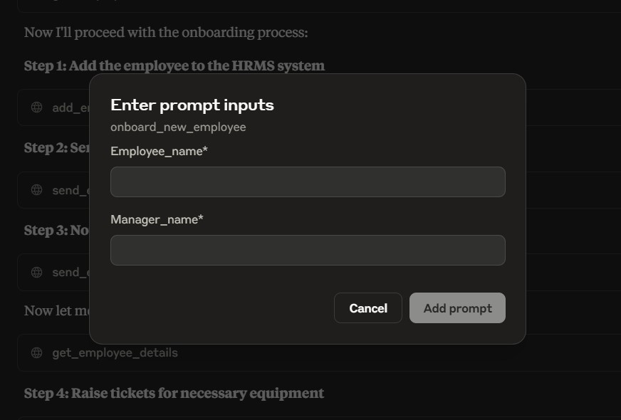

# AtliQ HR Assist

AtliQ HR Assist is a Model Context Protocol (MCP) server that gives an MCP-compatible AI client a small set of HR operations. It is designed to run locally over standard input/output and can be connected to Claude Desktop.

The server includes sample employee, leave, meeting, and ticket data at startup. Employee onboarding is exposed as an MCP prompt that guides the client through the available tools.

## Onboarding prompt in Claude Desktop

The `Onboard_new_employee` prompt asks for an employee and manager name, then guides the client through the onboarding steps. Here is the prompt input dialog in Claude Desktop:



## Features

- Add an employee and look up employee details by name.
- Send an email through Gmail SMTP.
- Create equipment or other service tickets.
- Schedule a meeting for an employee.
- Use the `Onboard_new_employee` prompt to coordinate an onboarding workflow.

## MCP tools and prompt

| Name | Type | Purpose |
| --- | --- | --- |
| `add_employee` | Tool | Add an employee with a name, manager employee ID, and email. |
| `get_employee_details` | Tool | Find employee details using a name. |
| `send_email` | Tool | Send a message to one or more email addresses. Requires SMTP credentials. |
| `create_ticket` | Tool | Create an equipment or service ticket for an employee. |
| `create_meeting` | Tool | Schedule a meeting using an ISO 8601 date and time. |
| `Onboard_new_employee` | Prompt | Guide the client through adding an employee, sending notifications, raising tickets, and arranging a meeting. |

## Requirements

- Python 3.13 or newer
- [uv](https://docs.astral.sh/uv/)
- Claude Desktop or another MCP client that supports stdio servers
- Gmail SMTP credentials if you want to use the `send_email` tool

## Setup

Clone the repository and install the locked dependencies:

```powershell
git clone https://github.com/Aniruddh4980/AtliQ-HR-Assist.git
cd AtliQ-HR-Assist
uv sync
```

Email support reads these environment variables from a `.env` file in the project directory:

```dotenv
GOOGLE_EMAIL=you@gmail.com
GOOGLE_EMAIL_PWD=your-gmail-app-password
```

Copy `.env.example` to `.env` and fill in your values if you plan to send email. For Gmail, use an app password where required by your account settings. Keep `.env` private; do not commit credentials to GitHub. The other tools can be used without configuring email credentials.

## Run the server

Start the MCP server directly over stdio:

```powershell
uv run python server.py
```

The process is intended to be launched by an MCP client. It seeds demo records in memory each time it starts, so changes made during a session are not persisted after restart.

## Configure Claude Desktop

Add the server to Claude Desktop's MCP configuration file. Replace the example path with the absolute path to your clone. On Windows, the usual configuration file is `%APPDATA%\Claude\claude_desktop_config.json`.

```json
{
  "mcpServers": {
    "atliq-hr-assist": {
      "command": "F:\\path\\to\\Project-3-AtliQ-HR-Assist\\.venv\\Scripts\\python.exe",
      "args": [
        "F:\\path\\to\\Project-3-AtliQ-HR-Assist\\server.py"
      ]
    }
  }
}
```

After saving the configuration, restart Claude Desktop. If you use `send_email`, make sure the project `.env` file is in place before launching Claude Desktop.

## Run the tests

The pytest suite checks the MCP tools and onboarding prompt, including employee lookup behavior and the data passed to the ticket, meeting, and email services. Email delivery tests mock the SMTP connection and verify the message contents and successful handoff over both TLS and SSL; they do not send real email or require SMTP credentials.

Run the suite from the project root:

```powershell
uv run --with pytest pytest
```

The MCP server seeds demo data when `server` is imported by the tests. The tests replace its service dependencies with mocks, so test operations do not send email or alter live data.

## Project layout

```text
.
├── server.py             # MCP server, tools, and onboarding prompt
├── emails.py             # Gmail SMTP email helper
├── utils.py              # In-memory demo data seeding
├── tests/
│   ├── conftest.py        # Adds the project root to Python's import path for tests
│   └── test_mcp.py        # MCP tool and mocked email delivery tests
├── hrms/
│   ├── employee_manager.py
│   ├── leave_manager.py
│   ├── meeting_manager.py
│   ├── ticket_manager.py
│   └── schemas.py
└── docs/images/          # README screenshots
```

## Notes

- This is a sample HR assistant. Its records are in-memory demo data, not a persistent HR database.
- The onboarding prompt proposes a workflow to the AI client; the client invokes the tools as needed.
- Employee IDs used for manager and employee fields must match IDs in the seeded or added employee records.

## License

This project is open-source and available under the [MIT License](LICENSE).
